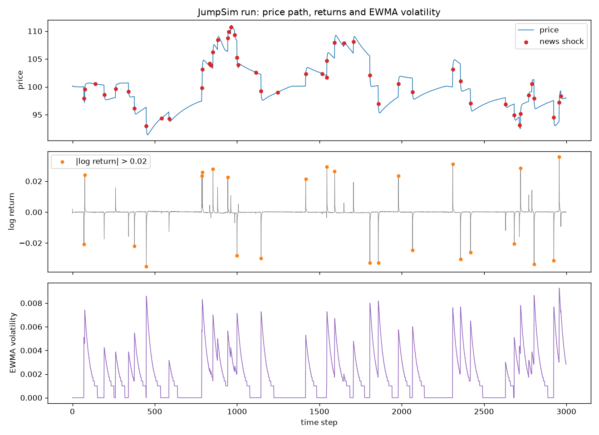
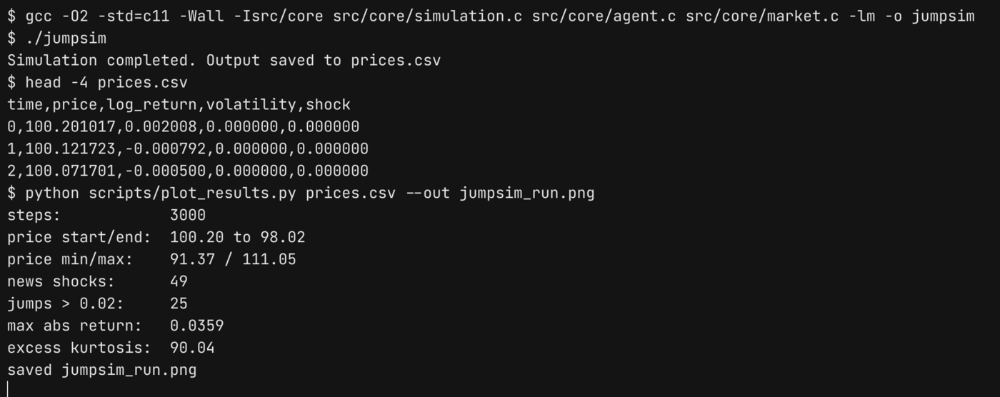

# JumpSim: Agent-Based Market Shock Simulator

[](LICENSE)


JumpSim is a small agent-based market simulator written in C. Retail, institutional and noise traders each turn their beliefs into buy/sell demand. The market adds up that demand and moves the price through a linear impact rule with finite liquidity. Rare news shocks hit agent **beliefs**, not the price. Any price jump comes from how agents react to the news, not from a jump term added to the price process.



*One 3,000-step run of `jumpsim` with the default parameters, plotted with `scripts/plot_results.py`. Red dots are steps with a news shock; orange dots are steps where the log return was above 0.02. Recorded on Ubuntu 22.04 with gcc 11.4. The simulator seeds itself from the clock, so every run gives different numbers.*



*The same run in a terminal: build, simulate, inspect `prices.csv`, plot.*

---

## Contents

- [What the simulator does](#what-the-simulator-does)
- [Quick start](#quick-start)
- [Output format](#output-format)
- [Repository layout](#repository-layout)
- [Experiment configs](#experiment-configs)
- [Known gaps](#known-gaps)
- [License](#license)

## What the simulator does

The program that runs today is `src/core/simulation.c`, linked with `agent.c` and `market.c`. Every time step it does the following:

1. **Population.** It creates 400 agents. Each agent is drawn at random as retail (60%), institutional (30%) or noise (10%).

   | Type          | Aggressiveness | Risk aversion | Noise std | Reaction to news                 |
   |---------------|---------------:|--------------:|----------:|----------------------------------|
   | Retail        | 1.0            | 0.2           | 0.6       | belief += 1.2 × shock (overreact) |
   | Institutional | 0.5            | 0.8           | 0.2       | belief += 0.4 × shock, anchored to a fundamental value of 100 |
   | Noise         | 0.2            | 0.1           | 1.0       | belief += shock × N(0,1)          |

2. **News.** With probability 1.5% per step, it draws a global shock uniformly from [-6, 6] and applies it to every agent's belief according to its type.
3. **Demand.** Each agent's demand is computed as

   ```
   demand = aggressiveness × (belief − price)
          − risk_aversion × position / (1 + |position|)
          + noise_std × N(0,1)
          + shock
   ```

   Institutions also add `0.5 × (fundamental − price)`. Orders smaller than the agent's liquidity tolerance (0.02) are dropped.
4. **Price formation.** The price moves by `ΔP = κ × ExcessDemand / Liquidity`, with κ = 1.0 and liquidity = 1200. Each step's move is capped at ±5.
5. **Learning.** Beliefs then move toward the observed price at a rate of 0.05 per step. Institutions move toward `0.7 × price + 0.3 × fundamental` instead.
6. **Diagnostics.** The simulator computes the log return and an EWMA variance (λ = 0.94, RiskMetrics style). If a log return exceeds 0.15, a circuit breaker halts trading.

The theory behind the model, its planned extensions and its intended uses are in [`docs/model_overview.md`](docs/model_overview.md).

## Quick start

You need a C compiler (gcc or clang). The plotting script needs Python 3.8+ with pandas and matplotlib.

### Linux / macOS / WSL

```bash
git clone https://github.com/bharathkrishna0/JumpSim-Agent-Based-Market-Shock-Simulator.git
cd JumpSim-Agent-Based-Market-Shock-Simulator

gcc -O2 -std=c11 -Wall -Isrc/core \
    src/core/simulation.c src/core/agent.c src/core/market.c \
    -lm -o jumpsim
./jumpsim                     # writes prices.csv in the current directory

pip install pandas matplotlib
python scripts/plot_results.py prices.csv --out jumpsim_run.png
```

### Windows (PowerShell, gcc from MSYS2 / MinGW-w64)

```powershell
git clone https://github.com/bharathkrishna0/JumpSim-Agent-Based-Market-Shock-Simulator.git
cd JumpSim-Agent-Based-Market-Shock-Simulator

gcc -O2 -std=c11 -Wall -Isrc/core src/core/simulation.c src/core/agent.c src/core/market.c -lm -o jumpsim.exe
.\jumpsim.exe

py -m pip install pandas matplotlib
py scripts\plot_results.py prices.csv --out jumpsim_run.png
```

`plot_results.py` prints a short summary of the run: price range, number of news shocks, number of jumps, largest absolute return and excess kurtosis. It also saves the three-panel figure shown above. Use `--jump-threshold` to change the return size that counts as a jump (default 0.02).

To change the population size, step count, agent mix or market parameters, edit the `#define`s and the `agent_init` / `market_init` arguments at the top of `src/core/simulation.c` and rebuild.

## Output format

`prices.csv` has one row per time step:

| Column       | Meaning |
|--------------|---------|
| `time`       | step index, starting at 0 |
| `price`      | market price after clearing |
| `log_return` | `ln(price_t / price_{t-1})` |
| `volatility` | EWMA **variance** of log returns, σ². Take the square root to get volatility. |
| `shock`      | news shock applied this step (0 when there was no news) |

All values are written with `%f` (6 decimal places). Small EWMA variances therefore get rounded down to a few distinct values, which is why the volatility panel looks like a staircase as it decays.

## Repository layout

```
src/
  core/
    simulation.c         main(): agent setup, time loop, CSV logging
    agent.h / agent.c    agent state, demand, belief update, shock response
    market.h / market.c  order-flow aggregation, price impact, EWMA, circuit breaker
  shocks/
    news.c               regime-switching heavy-tailed news process (not wired in yet)
    information_flow.c   network diffusion of news through neighbours (not wired in yet)
  utils/
    rng.c                rng.h-style declarations (no implementation yet)
    statistic.c          statistics.h-style declarations (no implementation yet)
experiments/             JSON scenario configs (baseline, high herding, low liquidity)
scripts/plot_results.py  summary stats and plots from prices.csv
docs/model_overview.md   model description
docs/media/              README images
```

## Experiment configs

`experiments/` holds three scenarios, each with an explicit random seed:

- `baseline_config.json`: the stable reference regime. It uses the same market and agent parameters as the defaults in `simulation.c`, but runs 5,000 steps instead of 3,000.
- `high_herding_config.json`: stronger social influence, less risk control and thinner liquidity.
- `low_liquidity_config.json`: liquidity 300 instead of 1200, with stronger price impact.

They describe planned scenarios. **The simulator does not read them yet.** See below.

## Known gaps

These are limits of the code as it stands today:

- **JSON configs are not loaded.** All parameters are hard-coded in `simulation.c`, and runs are seeded from `time(NULL)`, so they cannot be reproduced exactly.
- **`news.c` and `information_flow.c` are not linked into the program.** `simulation.c` uses its own simpler shock (1.5% chance, uniform ±6) and applies it to every agent directly. The regime-switching, heavy-tailed news process and the network diffusion code exist but have no header and are not called.
- **Herding is inactive.** The herding term is only used when an agent has neighbours, and no neighbour lists are built. In the figure above, jumps line up with news shocks. Jumps that arise purely from agent coordination have not been shown yet.
- **`src/utils/rng.c` and `statistic.c` contain only header declarations.** They have `.c` names and no implementations, so they are not part of the build. The plotting script computes the statistics instead.
- **The circuit breaker never releases once it trips.** While trading is halted, `market_clear` leaves `last_price` unchanged, so the triggering log return keeps being reported. With the ±5 cap this can only happen when the price is below about 36, which the default run never reaches.
- `requirements.txt` also lists packages that nothing in the repo uses yet (seaborn, mesa, scipy, Jupyter, tqdm). Only pandas and matplotlib are needed for `plot_results.py`.

## License

Released under the [MIT License](LICENSE).

## Author

Bharath Krishna
